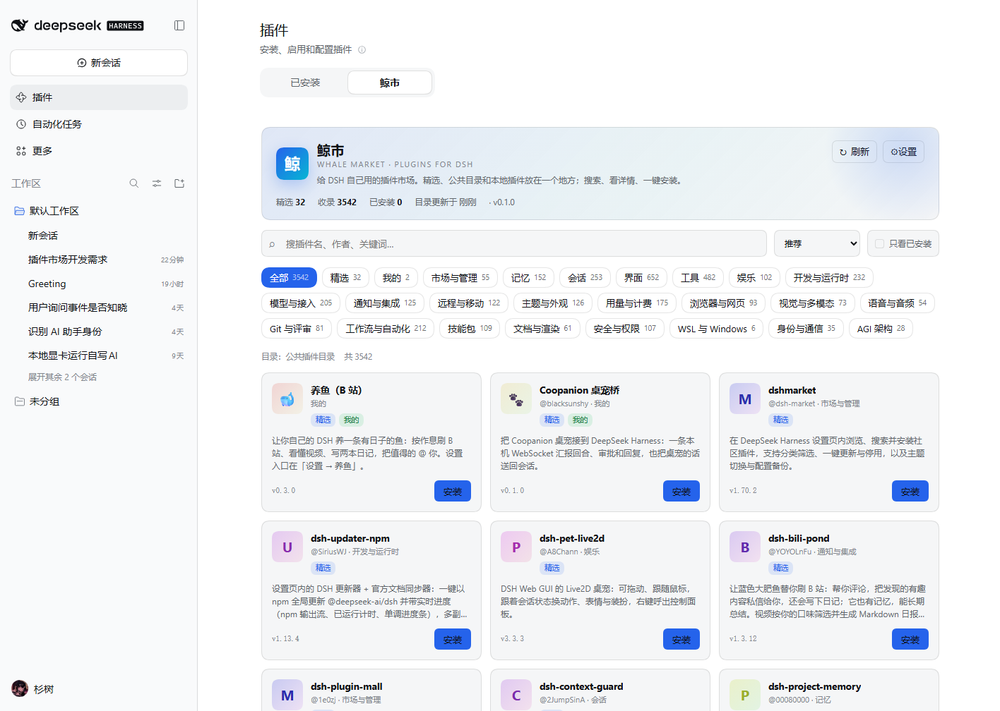
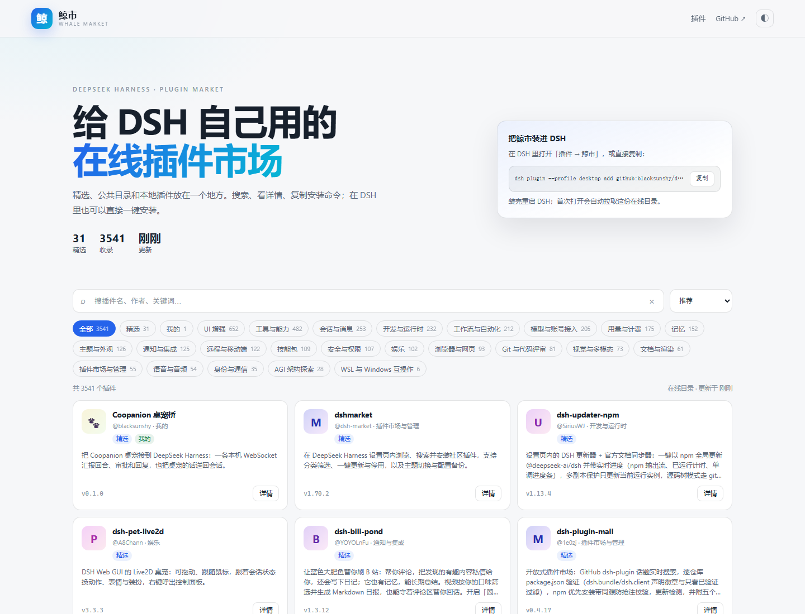

# 鲸市 · dsh-whale-market

> 给 DeepSeek Harness 自己用的插件市场：精选、公共目录和本地插件放在一个地方，搜索、看详情、一键安装。



---

## 它是什么

- **一个插件页，不是一个命令行脚本**：挂在侧边栏「插件」页的 **鲸市** 标签里，和「已安装」并列。
- **精选 + 公共目录**：随包带 32 个精选条目（含你自己的养鱼和 Coopanion 桌宠桥），默认再合并
  [`dsh-plugin-catalog`](https://cdn.jsdelivr.net/npm/dsh-plugin-catalog/index.json) 的 3500+ 个社区插件。
- **中文优先**：公共目录自带中英双语标题/描述，卡片按中文展示；分类、搜索、发布时间都能用。
- **一键安装 / 更新 / 卸载**：走 DSH 自己的 `pluginManager`，和「添加插件」是同一套 pnpm 流程，不是另起一套。
- **本地插件也收进来**：`data/personal.json` 里可以登记本地目录（`link:`）和 Git 仓库，装的时候仍然走插件管理器。
- **离线可用**：公共目录读取失败时，精选列表照常显示；上次成功读取的目录会缓存在本地。
- **没有遥测**：不往任何服务器上报使用数据；只在你点「刷新」或缓存过期时拉取目录。
- **不依赖实验开关**：不需要打开 DSH 的「自定义插件市场」实验功能，独立挂载。

## 在线版

除了插件里的「鲸市」标签，这个仓库还带一个**真正部署在公网的静态市场**：

> **https://blacksunshy.github.io/dsh-whale-market/**



- 页面本身就是市场：搜索、分类、排序、详情、复制安装命令。
- `site/index.json` 是同一份 format 1 目录，共 3500+ 条；由 `scripts/build-site.mjs` 合并精选和公共目录生成。
- 部署在 GitHub Pages，`.github/workflows/pages.yml` 每天自动重新生成并发布。
- 插件默认会先读这个在线目录；读不到时自动回退到公共目录和随包精选。

本地预览：

```bash
node scripts/build-site.mjs     # 生成 site/index.json
node scripts/serve-site.mjs     # http://127.0.0.1:4173/
```

### 部署到自己的 GitHub Pages

1. 在 GitHub 建一个空仓库，例如 `blacksunshy/dsh-whale-market`（public）。
2. 把本目录推到 `main`。
3. 仓库 **Settings → Pages → Build and deployment → Source** 选 **GitHub Actions**。
4. 推一次代码（或手动运行 `Deploy whale market` workflow），等 Pages 部署完成。
5. 如果用户名/仓库名不是 `blacksunshy/dsh-whale-market`，改 `market.config.json` 和
   `lib/index.js` 里的 `WHALE_SITE_URL`，再推一次。

第一次 push 时 Git Credential Manager 会让你登录 GitHub；登录一次之后就能一直推。

## 安装

前提：DSH 0.2.x，Node 22+（DSH 自带运行时即可）。

两种装法：

```bash
# A. 在线装（仓库推到 GitHub 之后）
dsh plugin --profile desktop add github:blacksunshy/dsh-whale-market

# B. 本地目录 link（开发时用）
dsh plugin --profile desktop add "link:C:\Users\<你>\Documents\deepseek-harness\default-workspace\dsh-whale-market"

# 装完重启 DSH（Desktop profile 只在启动时组装 bundle）
```

`dsh plugin add` 会自动把 `dsh-whale-market` 加进 profile 的 `dsh.profile.bundles`；
如果没加，手动在 `~/.dsh/profiles/desktop/package.json` 的 `dsh.profile.bundles` 末尾补一项：

```json
"dsh-whale-market"
```

装好后：侧边栏 **插件** → **鲸市**。

卸载：

```bash
dsh plugin --profile desktop remove dsh-whale-market
```

## 怎么用

1. 顶部搜索框输入包名、中文名、作者或关键词；搜索是服务端做的，3500 条也不会卡。
2. 分类 pills 可以筛「精选 / 我的 / 市场 / 记忆 / 界面 / …」；「只看已安装」可以快速找到装过的。
3. 点卡片看详情：完整描述、版本、发布时间、源码/主页、精确安装命令。
4. 点 **安装** 会先弹确认框，显示精确 spec（例如 `dsh-pet-live2d@3.3.3`）和第三方代码警告。
5. 安装过程有实时 pnpm 日志、已用时间、取消按钮；装完如果提示「需要重启」，重启 DSH 即可。
6. 已安装的条目会显示 **已安装 / 可更新 / 未启用**；更新会先卸载旧版再装新版，卸载会从 profile 移除依赖。

> ⚠️ 更新和卸载都依赖 DSH 的插件管理器。Desktop profile 没有启用 HMR 时，运行中的 bundle 不能被热移除，
> 会提示 `stop-profile`；这时请用「安装」页或命令行操作，然后重启 DSH。

## 目录源

一个市场就是一个 **format 1** JSON 文件。鲸市默认先读：

1. `https://blacksunshy.github.io/dsh-whale-market/index.json`（鲸市在线）
2. `https://cdn.jsdelivr.net/npm/dsh-plugin-catalog/index.json`（公共目录）
3. `https://dshmarket.com/index.json`（公共目录备用）

抓不到在线鲸市时（比如还没部署），会自动继续试公共地址；随包的 32 个精选始终在本地。

在 **设置**（右上角齿轮）里可以：

- 开关目录源；
- 添加任意 `http(s)` 的 format 1 地址；
- 移除源；
- 立即刷新（绕过缓存）；
- 恢复默认公共源。

缓存默认 6 小时，位置在 `~/.dsh/whale-market/cache/`；配置在 `~/.dsh/whale-market.json`。

### format 1 最小例子

```json
{
  "format": 1,
  "title": { "zh": "我的目录", "en": "My index" },
  "description": { "zh": "只给自己用的几个插件", "en": "A few plugins" },
  "metadata": {
    "categories": { "tools": { "title": { "zh": "工具", "en": "Tools" } } }
  },
  "plugins": [
    {
      "name": "dsh-whale-market",
      "title": { "zh": "鲸市", "en": "Whale Market" },
      "description": { "zh": "插件市场", "en": "Plugin market" },
      "homepage": "https://github.com/you/dsh-whale-market",
      "repository": { "url": "https://github.com/you/dsh-whale-market" },
      "metadata": { "category": "tools", "keywords": ["market"], "labels": [] },
      "versions": [
        {
          "version": "0.1.0",
          "publishTimestamp": 1790000000,
          "source": { "type": "npm" },
          "engines": { "dsh": ">=0.2.0" }
        }
      ]
    }
  ]
}
```

鲸市支持 `npm`、`git`、`link`、`tarball` 四种 `source`。Git 版本建议带 `commit`（精确到提交），
`path` 用于 monorepo 子目录；安装 spec 会生成 `git+https://...#<commit>&path:/<dir>`。

## 收自己的插件

编辑 `data/personal.json`，然后在有网时重新生成精选目录：

```bash
node tools/build-curated.mjs
```

`data/personal.json` 里的条目可以写：

```json
{
  "name": "dsh-bili-whale",
  "emoji": "🐋",
  "title": { "zh": "养鱼（B 站）", "en": "Bili Whale" },
  "description": { "zh": "……", "en": "……" },
  "note": "为什么把它放进精选",
  "category": "personal",
  "featured": 1,
  "localPath": "D:/AI/06-工具脚本/dsh-bili-whale",
  "versions": [
    { "version": "0.3.0", "source": { "type": "link", "path": "D:/AI/06-工具脚本/dsh-bili-whale" } }
  ]
}
```

`localPath` 只用于安装前检查目录是否存在；安装时用的是 `source.type: "link"` 的 spec。

## 安全边界

- 插件代码以你的权限运行；目录内容是第三方数据，不代表审计或背书。确认框里会明确写出精确 spec。
- 宿主所有路由都过 DSH 的 `connection.requestRejection` 信任栅栏；写操作（安装/卸载/启停/改源）还要求
  `Host` 是本机回环。
- 目录拉取：只允许 `http(s)`、拒绝重定向、25 秒超时、最大 16 MB；JSON 解析失败不会影响精选列表。
- 安装只接受「当前已加载目录里存在的插件名 + 版本」，不是任意 spec 安装器。
- 不加载远程 HTML，不执行目录里的脚本；图标是本地生成的字母/emoji，不请求远程图片。
- 无遥测、无账号、无云同步。

## 开发

```bash
# 宿主 API / 目录合并 / 安装状态测试（不需要 DSH 在跑）
node --test test/host.test.mjs test/remote.test.mjs

# 重新生成精选目录（需要联网）
node tools/build-curated.mjs

# 生成在线市场数据 + 本地预览
node scripts/build-site.mjs
node scripts/validate-index.mjs
node scripts/serve-site.mjs      # http://127.0.0.1:4173/

# 生成静态 UI 预览用的 mock 数据
node tools/make-preview-mock.mjs
```

目录结构：

```
dsh-whale-market/
├─ lib/index.js              宿主：目录、搜索、安装/卸载、信任栅栏
├─ lib/client.js             客户端：插件页「鲸市」标签
├─ data/curated.json         随包精选目录（离线可用）
├─ data/personal.json        自己的插件清单（生成 curated 的输入）
├─ site/                     在线市场：HTML/CSS/JS + 生成出的 index.json
├─ scripts/build-site.mjs    合并精选 + 公共目录 → site/index.json
├─ scripts/validate-index.mjs
├─ scripts/serve-site.mjs    本地静态服务器
├─ .github/workflows/pages.yml
├─ tools/build-curated.mjs
├─ tools/make-preview-mock.mjs
├─ test/                     宿主测试 + 静态预览
├─ cordis.patch.yml
├─ market.config.json        在线市场用户名/仓库/URL
└─ package.json
```

## 已知限制

- **更新不是原子的**：先移除旧版再装新版；如果新版安装失败，插件会处于未安装状态，重试即可。
- **Desktop 无 HMR 时不能热更新运行中的 bundle**：管理器会返回 `stop-profile`，需要重启或用命令行。
- **公共目录是社区数据**：条目可能过时、改名或下架；安装失败时以 pnpm/DSH 的报错为准。
- **目录一次性读入内存**：3500 条约 2.4 MB，搜索走内存；更大的目录需要服务端查询协议。
- **没有签名校验**：目录里的版本号是目录作者的声明；真正装上的 manifest 才作数。
- **图标是生成的**：不请求远程图片，所以视觉上比带图标的目录朴素一些。

## License

MIT
